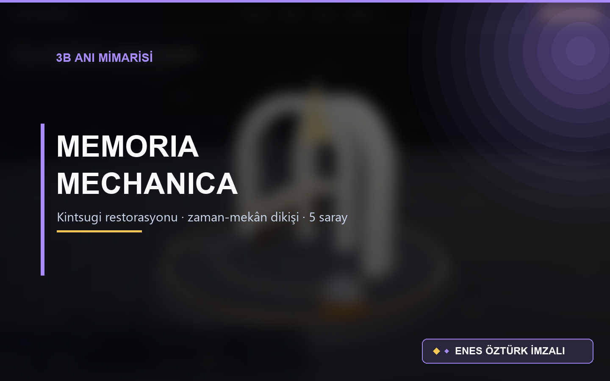
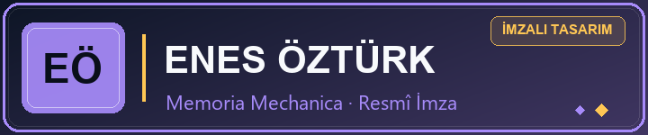
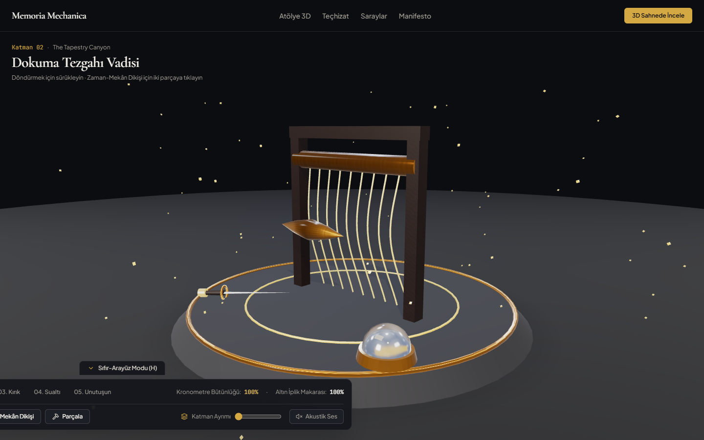
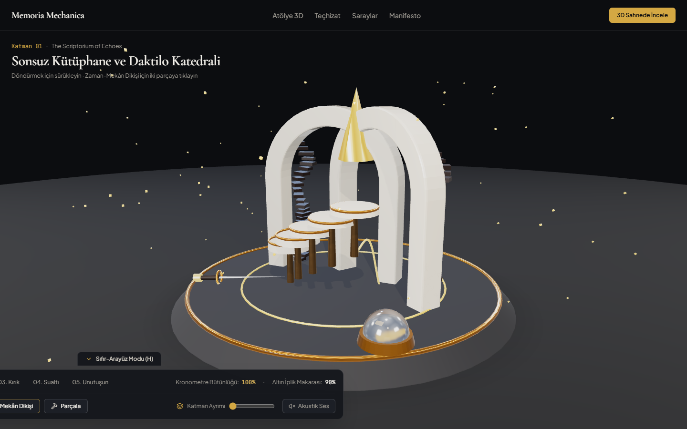

<div align="center">



# Memoria Mechanica: The Sovereign Weaver

**Enes Öztürk imzalı; kintsugi restorasyonu ve zaman-mekân dikişiyle anıları onardığınız, savaş ile zanaatı birleştiren 3B anı-mimarisi vitrini.**

[](https://github.com/EnesBinMalik/memoria-mechanica-sovereign-weaver)
[](https://react.dev/)
[](https://www.typescriptlang.org/)
[](https://threejs.org/)
[](https://vite.dev/)

[](https://github.com/EnesBinMalik)
[](https://github.com/EnesBinMalik/memoria-mechanica-sovereign-weaver)
[](https://github.com/EnesBinMalik/memoria-mechanica-sovereign-weaver)
[](https://github.com/EnesBinMalik/memoria-mechanica-sovereign-weaver)



</div>

---

## Hakkında

**Memoria Mechanica**, kırılmış anıları altınla onarıp yeniden dokuduğunuz bir 3B restorasyon ve aksiyon deneyimidir. Baş Restoratör Enes Öztürk'ün teçhizatı—gümüş ve altın telkari devreler, gerçek zamanlı atan **Kristal Kalp Kronometresi** ve pirinç mekanizmalı deri eldivenler—oyuncunun tüm durumunu doğrudan gövdesinde taşır; ayrı bir can çubuğu yoktur.

3D sahnede kırık parçaları sürükleyip döndürür, iki parçaya tıklayarak **Zaman-Mekân Dikişi** kurarsınız. Yaptığınız her kintsugi onarımı teçhizattaki altın zemberek gerginliğini ve hafıza ipliği makarasını doğrudan değiştirir. Dünyayı onardıkça müzik de dönüşür: sentetik ses yoktur, her şey gerçek zanaat foley akustiğiyle üretilir.

> Bu proje **Enes Öztürk** tarafından tasarlanmış, geliştirilmiş ve imzalanmıştır.

---

## Öne çıkan özellikler

| Özellik | Açıklama |
| --- | --- |
| **Kintsugi onarımı** | `Altınla Onar` ile kırık anı-kristallerini altınla birleştirme. |
| **Zaman-Mekân Dikişi** | 3D sahnede iki parçaya tıklayıp kopan zamanı yeniden dokuma. |
| **Mekik Kılıç** | El dövmesi çelik ve cilalı cevizden üretilen, altın hafıza iplikleri bırakan silah. |
| **Diegetik okuma** | Kristal Kalp ve iplik makarası tüm durumu teçhizat üzerinde gösterir. |
| **5 anı sarayı** | Sonsuz, Dokuma, Kırık, Sualtı ve Unutuş katmanları. |
| **Zanaat foley akustiği** | Daktilo, tezgâh mekiği ve pirinç müzik kutusu sesleriyle senfoni. |
| **Sıfır-arayüz modu** | `H` ile tüm paneli kaldırıp yalnızca teçhizatı okuma. |
| **Pop-up zanaatkâr kitabı** | Teçhizat, saray ve silah loru için opens kitap arayüzü. |

---

## Anı sarayları

| # | Katman | Konsept |
| --- | --- | --- |
| 01 | Sonsuz Kütüphane ve Daktilo Katedrali | Yankı yazı kemerleri ve vitray şehri |
| 02 | Dokuma Tezgahı Vadisi | Bulutlar arası dev tezgâhlar ve altın halatlar |
| 03 | Kırık Saray | Parçalanmış anılar ve kintsugi kemerleri |
| 04 | Sualtı Saat ve Müzik Kutusu Mahzeni | Dev pirinç silindir ve çelik taraklar |
| 05 | Unutuşun Sarayı | Obsidyen çekirdek ve hafızanın son kalesi |

Her bölge kendi fizik kuralları, ışıklandırması, dokusu ve akustik karakteriyle ayrı bir deneyim sunar.

---

## Kontroller

| Tuş | Aksiyon |
| --- | --- |
| `Fare` (sürükle) | 3D sahnede döndürme |
| `Tık` (iki parça) | Zaman-Mekân Dikişi kurma |
| `01`–`05` | Anı sarayı katmanı seçimi |
| `Altınla Onar` | Kintsugi restorasyonu |
| `Parçala` | Parçaları ayrı inceleme |
| `Katman Ayrımı` | Mimari katmanları göster / gizle |
| `H` | Sıfır-arayüz modu |

> Oyun sırasında arayüz tamamen kaldırılabilir: ekranda yalnızca dünya içi telemetri kalır.

---

## Galeri






---

## Kurulum

**Gereksinimler:** Node.js 20+ ve modern bir WebGL tarayıcı.

```bash
git clone https://github.com/EnesBinMalik/memoria-mechanica-sovereign-weaver.git
cd memoria-mechanica-sovereign-weaver
npm install
npm run dev
```

Uygulama varsayılan olarak `http://localhost:3000` adresinde açılır.

> Deneyim tamamen istemci tarafında çalışır; harici motor veya API anahtarı gerekmez.

Diğer komutlar:

```bash
npm run build     # Üretim derlemesi (dist/)
npm run preview   # Derlemeyi yerelde önizle
npm run lint      # TypeScript tip kontrolü
```

---

## Teknik mimari

```text
src/engine/           3D restorasyon sahnesi ve dikiş fiziği
src/three/            Saray, teçhizat ve parça modelleri
src/audio/            Zanaat foley akustik motoru
src/components/       Atölye, teçhizat, saray ve manifesto panelleri
src/data/             Anı sarayı ve teçhizat loru
```

---

## İmza

<div align="center">

[](https://github.com/EnesBinMalik)
[](https://github.com/EnesBinMalik)

**Bu kod, tasarım ve deneyim Enes Öztürk'ün kişisel imzasını taşır.**

© 2026 Enes Öztürk — Tüm hakları saklıdır.

</div>
